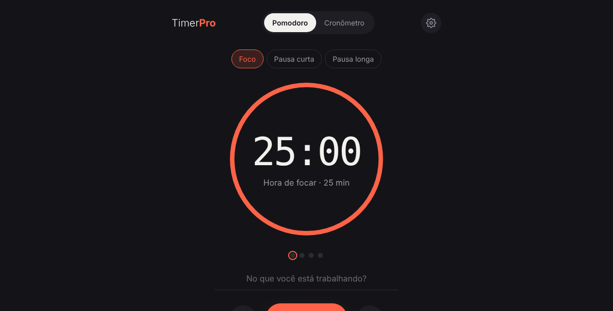

# TimerPro — Pomodoro e cronômetro

Cronômetro com modo Pomodoro integrado, com ciclos de foco e pausa configuráveis para aumentar a produtividade.

🔗 **[Ver o site no ar](https://iamviniciuslima05.github.io/PROJETO-TimerPro/)**



## Funcionalidades

- **Pomodoro** com foco, pausa curta e pausa longa
- Tempos e número de ciclos **configuráveis**
- Opção de **começar a próxima fase sozinho**
- **Som** ao terminar cada fase e notificação do navegador
- Campo “no que você está trabalhando” e **registro das sessões do dia**
- Estatísticas: pomodoros, minutos de foco e **dias seguidos**
- **Cronômetro** com centésimos e **voltas** (destaca a mais rápida e a mais lenta)
- Tempo restante aparece no **título da aba**
- Atalhos: espaço, R, N e V

## Tecnologias

HTML5 · CSS3 · JavaScript · Web Audio API · localStorage

## Estrutura

```
index.html
css/style.css
js/script.js
```

## Como rodar

Não precisa instalar nada: baixe o projeto e abra o `index.html` no navegador, ou acesse a versão publicada acima.

---
Feito por **Vinicius Lima** · [Portfólio](https://viniciuslimadev.netlify.app) · [LinkedIn](https://www.linkedin.com/in/viniciuslima25/)
